# v-pm-planning-loop — architecture spec

## File tree

```text
personas/_shared/planning/README.md                        new
personas/_shared/planning/solution-architect.md            new
personas/_shared/planning/codebase-fit.md                  new
personas/_shared/planning/lazy-dev.md                      new
personas/_shared/planning/future-scope.md                  new
personas/_shared/planning/system-integration.md            new
personas/_shared/planning/security-architect.md            new
personas/_shared/planning/harness-engineer.md              new
personas/_shared/planning/delivery-planner.md              new
personas/_resolution.md                                    existing
tests/unit/planning-personas.bats                          new
checks/pm-loop-SC-1.sh                                     existing
templates/feature-plan.md                                  new
templates/master-plan.md                                   existing
templates/handoff.md                                       existing
bin/pm-plan.sh                                             new
tests/fixtures/pm/valid/                                   new
tests/unit/pm-plan.bats                                    new
checks/pm-loop-SC-2.sh                                     existing
checks/pm-loop-SC-5.sh                                     existing
commands/v-pm.md                                           existing
commands/v-pm/steps/01-intake.md                           existing
commands/_shared/elicitation.md                            existing
commands/v-pm/steps/02-load-context.md                     existing
commands/v-pm/steps/03-plan-panel.md                       existing
commands/v-team/steps/03-propose-loop.md                   existing
commands/v-pm/steps/04-seed-workspace.md                   existing
commands/v-pm/steps/05-capture.md                          existing
commands/v-pm/steps/06-reconcile.md                        existing
commands/v-pm/steps/07-status.md                           existing
tests/unit/v-pm.bats                                       existing
tests/unit/research-clarify.bats                           existing
tests/unit/document-standard.bats                          existing
checks/pm-loop-SC-3.sh                                     existing
commands/_shared/feature-pickup.md                         new
commands/v-work.md                                         existing
commands/v-work/steps/01-analyze.md                        existing
commands/v-work/steps/03-propose.md                        existing
commands/v-work/steps/05-commit-capture.md                 existing
commands/v-team.md                                         existing
commands/v-team/steps/04-execute-loop.md                   existing
commands/v-capture.md                                      existing
commands/v-do.md                                           existing
checks/master-SC-5.sh                                      existing
tests/unit/v-team.bats                                     existing
checks/pm-loop-SC-4.sh                                     existing
checks/pm-loop-SC-6.sh                                     existing
templates/_features/project-shard.md                       existing
templates/_features/generic-plan.md                        existing
templates/_features/planning-session.md                    existing
templates/_features/header.md                              existing
templates/_features/requirements.md                        existing
templates/trail.md                                         existing
commands/v-method.md                                       existing
templates/method.md                                        existing
vault-guide.md                                             existing
docs/cross-project-workspaces.md                           existing
docs/commands.md                                           existing
README.md                                                  existing
_moc.md                                                    existing
vault/decisions/ADR-033-v-pm-planning-loop.md              new
vault/decisions/_inventory.md                              existing
vault/indications/pm-plans-sessions.md                     new
vault/indications/plan-appetite-not-tasks.md               existing
vault/indications/_index.md                                existing
vault/features/v-pm.md                                     existing
vault/features/v-method.md                                 existing
```

## Files

| path | new | purpose | loaded |
|------|-----|---------|--------|
| personas/_shared/planning/README.md | yes | new: lens table with "not mine, goes to", grounding rule (D-3), tier table and cap precedence (D-4), reuse note | on-demand |
| personas/_shared/planning/solution-architect.md | yes | new lens from vault/research/v-pm-planning-lenses/architect.md | on-demand |
| personas/_shared/planning/codebase-fit.md | yes | new lens from vault/research/v-pm-planning-lenses/fit-and-lazy.md | on-demand |
| personas/_shared/planning/lazy-dev.md | yes | new lens with the package evidence card | on-demand |
| personas/_shared/planning/future-scope.md | yes | new lens from vault/research/v-pm-planning-lenses/future-scope.md with the one-way-door rule | on-demand |
| personas/_shared/planning/system-integration.md | yes | new lens from vault/research/v-pm-planning-lenses/system-integration.md | on-demand |
| personas/_shared/planning/security-architect.md | yes | new lens from vault/research/v-pm-planning-lenses/security-architect.md | on-demand |
| personas/_shared/planning/harness-engineer.md | yes | new lens from vault/research/v-pm-planning-lenses/harness-engineer.md | on-demand |
| personas/_shared/planning/delivery-planner.md | yes | new lens from vault/research/v-pm-planning-lenses/delivery-planner.md, carrying the (f3) sizing rules (D-15) | on-demand |
| personas/_resolution.md | no | add §2.3 planning-group selection by tier and trigger | on-demand |
| tests/unit/planning-personas.bats | yes | new: lens files, caps, sections, selection, tier thresholds, the moved sizing rules | never-by-agent |
| checks/pm-loop-SC-1.sh | no | grader | never-by-agent |
| templates/feature-plan.md | yes | new: Need, Scale, Success criteria with sessions, Definition of done DD-1 to DD-4, Decisions, Solution shape, Sessions, Cross-session contracts, Risks and rollback | on-demand |
| templates/master-plan.md | no | define the optional repo, req and deviation columns (D-6) | on-demand |
| templates/handoff.md | no | add the optional id key and the brief use (D-7) | on-demand |
| bin/pm-plan.sh | yes | new: check, order, set (D-9) | never-by-agent |
| tests/fixtures/pm/valid/ | yes | new: one valid plan with two briefs | never-by-agent |
| tests/unit/pm-plan.bats | yes | new: the SC-2 variants, set, concurrent set | never-by-agent |
| checks/pm-loop-SC-2.sh | no | graders | never-by-agent |
| checks/pm-loop-SC-5.sh | no | graders | never-by-agent |
| commands/v-pm.md | no | rewrite plan mode: INTAKE, LOAD CONTEXT, PLAN PANEL, APPROVAL GATE, SEED, CAPTURE | on-demand |
| commands/v-pm/steps/01-intake.md | no | add the success-criteria refusal with its reply text (D-18), the done lines (D-19), the scale tier (D-4) and the single-repo plan home | on-demand |
| commands/_shared/elicitation.md | no | state the /v-pm exception and the single home of the criteria (D-18) | on-demand |
| commands/v-pm/steps/02-load-context.md | no | add read-only code orientation and the path index handed to reviewers | on-demand |
| commands/v-pm/steps/03-plan-panel.md | no | rewrite: research, draft plan and briefs, parallel panel, converge, pm-plan.sh check | on-demand |
| commands/v-team/steps/03-propose-loop.md | no | §(e).6 names the caller's trail sidecar (D-1) | on-demand |
| commands/v-pm/steps/04-seed-workspace.md | no | rewrite: symlinks and shard stubs for multi-repo | on-demand |
| commands/v-pm/steps/05-capture.md | no | the trail replaces the planning record | on-demand |
| commands/v-pm/steps/06-reconcile.md | no | convert shard rows with operator-confirmed mapping | on-demand |
| commands/v-pm/steps/07-status.md | no | read the tracker through feature pickup's resolver | on-demand |
| tests/unit/v-pm.bats | no | update for the new steps | never-by-agent |
| tests/unit/research-clarify.bats | no | update for the new steps | never-by-agent |
| tests/unit/document-standard.bats | no | update for the new steps | never-by-agent |
| checks/pm-loop-SC-3.sh | no | grader | never-by-agent |
| commands/_shared/feature-pickup.md | yes | git mv from commands/v-team/steps/00-feature-pickup.md, extended per D-11 | on-demand |
| commands/v-work.md | no | task 0 and Step 0 run feature pickup when the task names a session | on-demand |
| commands/v-work/steps/01-analyze.md | no | §1.4c: no fast path with a session | on-demand |
| commands/v-work/steps/03-propose.md | no | write session_of as an absolute path | on-demand |
| commands/v-work/steps/05-commit-capture.md | no | move the master-row bullet from step 5.0 to a new step 5.1a after the code commit (D-12, D-13) | on-demand |
| commands/v-team.md | no | Step 0 points to commands/_shared/feature-pickup.md | on-demand |
| commands/v-team/steps/04-execute-loop.md | no | each row duty references feature pickup's tracker resolver in one line | on-demand |
| commands/v-capture.md | no | each row duty references feature pickup's tracker resolver in one line | on-demand |
| commands/v-do.md | no | each row duty references feature pickup's tracker resolver in one line | on-demand |
| checks/master-SC-5.sh | no | delete | never-by-agent |
| tests/unit/v-team.bats | no | replace the (f3) and Step 0 path tests | never-by-agent |
| checks/pm-loop-SC-4.sh | no | graders | never-by-agent |
| checks/pm-loop-SC-6.sh | no | graders | never-by-agent |
| templates/_features/project-shard.md | no | delete the three tracker sections (D-16) | on-demand |
| templates/_features/generic-plan.md | no | delete | on-demand |
| templates/_features/planning-session.md | no | delete | on-demand |
| templates/_features/header.md | no | point to plan.md, the success-criteria home and plan.trail.md | on-demand |
| templates/_features/requirements.md | no | point to plan.md, the success-criteria home and plan.trail.md | on-demand |
| templates/trail.md | no | point to plan.md, the success-criteria home and plan.trail.md | on-demand |
| commands/v-method.md | no | read the session count from plan.md | on-demand |
| templates/method.md | no | read the session count from plan.md | on-demand |
| vault-guide.md | no | new layout | on-demand |
| docs/cross-project-workspaces.md | no | new layout | on-demand |
| docs/commands.md | no | new layout | on-demand |
| README.md | no | new layout | on-demand |
| _moc.md | no | new layout | on-demand |
| vault/decisions/ADR-033-v-pm-planning-loop.md | yes | new ADR per D-20, inventory row | on-demand |
| vault/decisions/_inventory.md | no | new ADR per D-20, inventory row | on-demand |
| vault/indications/pm-plans-sessions.md | yes | replace the indication (D-21) | on-demand |
| vault/indications/plan-appetite-not-tasks.md | no | replace the indication (D-21) | on-demand |
| vault/indications/_index.md | no | replace the indication (D-21) | on-demand |
| vault/features/v-pm.md | no | rewrite the dossier | on-demand |
| vault/features/v-method.md | no | rewrite the dossier | on-demand |

## Data flow

```mermaid
flowchart LR
    I["01-intake"] -->|"need, criteria, repos, tier"| L["02-load-context"]
    L -->|"digest, path index"| P["03-plan-panel"]
    R["personas/_shared/planning"] -->|"lens blocks"| P
    P -->|"plan.md, briefs/, pm-plan.sh check"| G["approval gate"]
    G -->|"approved plan"| S["04-seed-workspace"]
    S -->|"symlinks, shards"| C["05-capture"]
    C -->|"order, first-wave run lines"| O["operator"]
    O -->|"run line"| F["_shared/feature-pickup"]
    F -->|"order, set doing, session_of"| X["05-commit-capture step 5.1a"]
    X -->|"set done via vault-sync.sh"| M["plan.md Sessions"]
```



## Interfaces

| interface | method | params | returns | throws | layer |
|-----------|--------|--------|---------|--------|-------|
| bin/pm-plan.sh | check | plan: path | exit 0, or exit 1 with one line per defect | exit 2 unreadable plan | cli |
| bin/pm-plan.sh | order | plan: path | one line per session: wave, id, status, readiness, repo, brief | exit 1 on a depends cycle | cli |
| bin/pm-plan.sh | set | plan: path, id: string, assignments: string | rewrites one row under flock | exit 1 unknown id or column | cli |
| commands/_shared/feature-pickup.md | step 0 | locator: string | the brief goal as the task restatement | ends the session when the row is not todo runnable | command |

## Load order

| trigger | loads | tokens-max |
|---------|-------|------------|
| /v-pm step 03 seats reviewers | personas/_shared/planning/README.md | 2500 |
| /v-pm step 03 spawns one reviewer | one lens file of personas/_shared/planning | 2500 |
| /v-pm step 03 drafts sessions | templates/feature-plan.md and templates/handoff.md | 3500 |
| /v-work or /v-team names a session | commands/_shared/feature-pickup.md and the one brief under briefs/ | 3500 |

## Reuse map

| need | existing symbol | decision | reason |
|------|-----------------|----------|--------|
| review loop, finding schema, synthesizer | commands/v-team/steps/03-propose-loop.md §(c)-(f) | reuse | one loop definition |
| Sessions and contracts tables | templates/master-plan.md | extend | adds optional repo, req and deviation columns |
| session brief | templates/handoff.md | extend | adds the id key; the next session already reads that shape |
| Step 0 of a feature session | commands/v-team/steps/00-feature-pickup.md | extend | moved to commands/_shared/ and shared by /v-work |
| contract check | bin/gate.sh master | reuse | already reads columns by name |
| markdown table parsing in pm-plan.sh | bin/gate.sh table_rows | reuse | gate.sh is sourceable without running main |
| row write in another repo | bin/vault-sync.sh | reuse | pull and push with explicit paths |
| handoff dry run | personas/_shared/consumer.md | reuse | the run lines are handoffs |
| assumption check | personas/_shared/skeptic.md | reuse | high-risk plans |
| planning record | templates/trail.md | reuse | replaces planning-session.md |
| wave layering and cycle detection | none | new | searched lib/master-check.sh and bin/gate.sh: self-loop check only, no layering |

## Size budgets

| path | max lines |
|------|-----------|
| personas/_shared/planning/README.md | 150 |
| personas/_shared/planning/solution-architect.md | 150 |
| personas/_shared/planning/codebase-fit.md | 150 |
| personas/_shared/planning/lazy-dev.md | 150 |
| personas/_shared/planning/future-scope.md | 150 |
| personas/_shared/planning/system-integration.md | 150 |
| personas/_shared/planning/security-architect.md | 150 |
| personas/_shared/planning/harness-engineer.md | 150 |
| personas/_shared/planning/delivery-planner.md | 150 |
| templates/feature-plan.md | 150 |
| bin/pm-plan.sh | 250 |
| commands/v-pm/steps/03-plan-panel.md | 150 |
| commands/_shared/feature-pickup.md | 130 |

## Config points

| key | file | default |
|-----|------|---------|
| team_max_parallel_critics | VAULT.md | unset; when set it caps the tier's per-run reviewer count (3, 4, 5) |
| team_max_rounds | VAULT.md | unset; when set it caps the tier's per-run round count (1, 2, 2) |
