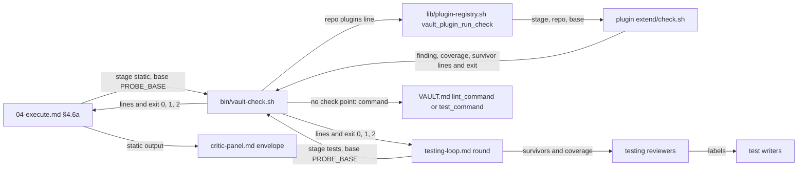

# quality-loops — architecture spec

## File tree

```text
lib/vault-md.sh                                              new, the shared VAULT.md key reader
bin/probe.sh                                                 existing, sources lib/vault-md.sh
lib/plugin-registry.sh                                       existing, gains the check point, opt-in reader and vault_plugin_run_check
lib/shared-module-rules.tsv                                  existing, rule owners move to testing-loop.md
bin/vault-check.sh                                           new, the one entry point both loops call
tests/fixtures/plugins/check-plugin/extend/plugin.tsv        new, fixture manifest
tests/fixtures/plugins/check-plugin/extend/check.sh          new, fixture point
tests/unit/vault-check.bats                                  new
tests/unit/plugin-registry.bats                              existing, gains check cases
vault/architecture/plugin-extension-contract.md              existing, gains the check row
commands/_shared/testing-loop.md                             new, the testing loop for both commands
commands/v-work/steps/04-execute.md                          existing, gains §4.6a and calls the testing loop
commands/v-team/steps/04-execute-loop.md                     existing, renumbered into three loops
commands/v-team.md                                           existing, Step 5 names the loops
commands/_shared/definition-of-done.md                       existing, B2 points at the testing loop
commands/_shared/critic-panel.md                             existing, static output in envelope, drop rule, evidence kinds
personas/_shared/quality.md                                  existing, rewritten to design simplicity
personas/_shared/performance.md                              existing, rewritten to approach cost
personas/_resolution.md                                      existing, diff-review default seats
personas/api-laravel.md                                      existing, overlay strings
personas/nuxt.md                                             existing, overlay strings
personas/flutter.md                                          existing, overlay strings
personas/_persona-template.md                                existing, evidence line
personas/_shared/testing/design/api-contract-mapper.md       new generator
personas/_shared/testing/design/abuse-case-designer.md       new generator
personas/_shared/testing/design/performance-budget-designer.md  new generator
personas/_shared/testing/design/README.md                    existing, six generators and triggers
commands/v-team/steps/03-propose-loop.md                     existing, (f2) selection by README
personas/_shared/testing/system-domain-expert.md             existing, loop reference
vault/indications/generators-emit-critics-confirm.md         existing, loop reference
templates/VAULT.md                                           existing, two commented keys
vault/decisions/ADR-034-three-execute-loops.md               new
vault/decisions/_inventory.md                                existing, registers ADR-034
checks/quality-loops-SC-1.sh                                 new, one of seven checks
```

## Files

| path | new | purpose | loaded |
|------|-----|---------|--------|
| lib/vault-md.sh | yes | read one `key:` value from a repo's VAULT.md | never-by-agent |
| bin/probe.sh | no | run the probe kit on a repo | never-by-agent |
| lib/plugin-registry.sh | no | run a plugin's extension points | never-by-agent |
| lib/shared-module-rules.tsv | no | name the owner of each shared rule | never-by-agent |
| bin/vault-check.sh | yes | run the opted-in `check` points for a stage, or the repo's own command | never-by-agent |
| tests/fixtures/plugins/check-plugin/extend/plugin.tsv | yes | declare a fixture plugin with the check point | never-by-agent |
| tests/fixtures/plugins/check-plugin/extend/check.sh | yes | print one line of each kind and exit as told | never-by-agent |
| tests/unit/vault-check.bats | yes | prove the exit mapping and the fallback | never-by-agent |
| tests/unit/plugin-registry.bats | no | prove registration rules | never-by-agent |
| vault/architecture/plugin-extension-contract.md | no | define what a plugin ships and how it is called | on-demand |
| commands/_shared/testing-loop.md | yes | define the testing loop's seats, round and stop rule | on-demand |
| commands/v-work/steps/04-execute.md | no | define `/v-work` EXECUTE | on-demand |
| commands/v-team/steps/04-execute-loop.md | no | define `/v-team` EXECUTE | on-demand |
| commands/v-team.md | no | dispatch the `/v-team` steps | on-demand |
| commands/_shared/definition-of-done.md | no | define the close checklist | on-demand |
| commands/_shared/critic-panel.md | no | define one critic-panel pass | on-demand |
| personas/_shared/quality.md | no | review design simplicity and reuse | on-demand |
| personas/_shared/performance.md | no | review the cost of the approach | on-demand |
| personas/_resolution.md | no | select the critics for a change | on-demand |
| personas/api-laravel.md | no | bind Laravel tools to the lenses | on-demand |
| personas/nuxt.md | no | bind Nuxt tools to the lenses | on-demand |
| personas/flutter.md | no | bind Flutter tools to the lenses | on-demand |
| personas/_persona-template.md | no | give authors the persona shape | on-demand |
| personas/_shared/testing/design/api-contract-mapper.md | yes | design per-endpoint contract tests | on-demand |
| personas/_shared/testing/design/abuse-case-designer.md | yes | design attack tests | on-demand |
| personas/_shared/testing/design/performance-budget-designer.md | yes | design query and time budget tests | on-demand |
| personas/_shared/testing/design/README.md | no | select generators and route their rows | on-demand |
| commands/v-team/steps/03-propose-loop.md | no | define `/v-team` PROPOSE | on-demand |
| personas/_shared/testing/system-domain-expert.md | no | confirm business rules are tested | on-demand |
| vault/indications/generators-emit-critics-confirm.md | no | keep generators and critics apart by phase | on-demand |
| templates/VAULT.md | no | give a new repo its config | never-by-agent |
| vault/decisions/ADR-034-three-execute-loops.md | yes | record the three-loop decision | on-demand |
| vault/decisions/_inventory.md | no | list every ADR | on-demand |
| checks/quality-loops-SC-1.sh | yes | decide SC-1 | never-by-agent |

## Data flow



## Interfaces

| interface | method | params | returns | throws | layer |
|-----------|--------|--------|---------|--------|-------|
| bin/vault-check.sh | static | repo: path, base: ref | exit 0, 1 or 2 with check lines | - | cli |
| bin/vault-check.sh | tests | repo: path, base: ref | exit 0, 1 or 2 with check lines | - | cli |
| lib/plugin-registry.sh | vault_plugin_run_check | stage: string, repo: path, base: ref | highest point exit, clamped to 2 | - | lib |
| lib/plugin-registry.sh | vault_plugin_check_declared | repo: path | 0 when an opted-in plugin declares check, else 1 | - | lib |
| lib/plugin-registry.sh | vault_plugin_opted_in | vault_md: path | plugin names one per line; 2 on two plugins lines | - | lib |
| lib/vault-md.sh | vault_md_key | repo: path, key: string | the value, or 1 when the file or key is absent | - | lib |
| extend/check.sh | static | repo: path, base: ref | exit 0, 1 or 2 with check lines | - | plugin |
| extend/check.sh | tests | repo: path, base: ref | exit 0, 1 or 2 with check lines | - | plugin |

## Load order

| trigger | loads | tokens-max |
|---------|-------|------------|
| `/v-work` or `/v-team` EXECUTE reaches the testing loop | commands/_shared/testing-loop.md | 2500 |
| `/v-team` §(f2) selects designers | personas/_shared/testing/design/README.md plus each seated generator | 7000 |
| a diff-review panel spawns | personas/_shared/quality.md and personas/_shared/performance.md when seated | 1500 |

## Reuse map

| need | existing symbol | decision | reason |
|------|-----------------|----------|--------|
| list registered plugins | lib/plugin-registry.sh vault_plugin_list | reuse | already validates the registry |
| find a point's file | lib/plugin-registry.sh vault_plugin_point_file | extend | gains the check mapping |
| run a point without sourcing it | lib/plugin-registry.sh vault_plugin_run_point | new | it ignores the repo's opt-in and always returns 0; searched `lib/plugin-registry.sh` for an exit-propagating runner, none exists |
| read a VAULT.md scalar | bin/probe.sh probe_vault_key | extend | moved into lib/vault-md.sh so bin/vault-check.sh shares it |
| read the plugins opt-in line | bin/gate.sh plugin_keys | new | its parser is inline in plugin_keys and bin/gate.sh holds uncommitted changes; the switch is deferred with a parity test |
| confirm a design finding | personas/_shared/planning/README.md Grounding rule | extend | adds the rewrite and the measurement |
| per-test gate | commands/v-team/steps/04-execute-loop.md §5.2 | extend | moves into commands/_shared/testing-loop.md |

## Size budgets

| path | max lines |
|------|-----------|
| bin/vault-check.sh | 200 |
| commands/_shared/testing-loop.md | 150 |
| personas/_shared/quality.md | 60 |
| personas/_shared/performance.md | 60 |
| personas/_shared/testing/design/api-contract-mapper.md | 55 |
| personas/_shared/testing/design/abuse-case-designer.md | 55 |
| personas/_shared/testing/design/performance-budget-designer.md | 55 |

## Config points

| key | file | default |
|-----|------|---------|
| plugins | VAULT.md | none, so no check point runs |
| team_max_test_rounds | VAULT.md | 3 |
| team_max_test_designers | VAULT.md | 5 |
| team_max_test_writers | VAULT.md | 2 |
| VAULT_CHECK_LINES | environment | 200 |
| VAULT_CHECK_BYTES | environment | 12000 |
| VAULT_CHECK_TIMEOUT | environment | 1800 |
