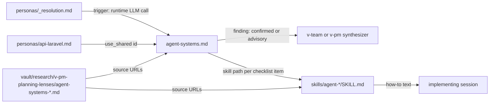

# 2026-10-20-1934-agent-systems-lens — architecture spec

## File tree

```text
personas/_shared/planning/agent-systems.md                       new, plan critic for agents a product runs for its users
personas/_shared/planning/README.md                              existing, three deliverable kinds; agent-systems row
personas/_shared/planning/security-architect.md                  existing, hands product agent runs to agent-systems
personas/_shared/planning/harness-engineer.md                    existing, scoped to developer harnesses
personas/_resolution.md                                          existing, §2 and §2.3 seat agent-systems on a runtime LLM call
personas/api-laravel.md                                          existing, use_shared gains planning/agent-systems
skills/agent-shape/SKILL.md                                      new
skills/agent-trust-boundaries/SKILL.md                           new
skills/agent-tools-mcp/SKILL.md                                  new
skills/agent-output-validation/SKILL.md                          new
skills/agent-knowledge-context/SKILL.md                          new
skills/agent-evals/SKILL.md                                      new
skills/agent-self-improvement/SKILL.md                           new
skills/agent-runtime-ops/SKILL.md                                new
vault/research/v-pm-planning-lenses/agent-systems-architecture.md  new, research record
vault/research/v-pm-planning-lenses/agent-systems-security.md      new, research record
vault/research/v-pm-planning-lenses/agent-systems-quality.md       new, research record
vault/_moc.md                                                    existing, one research line
install.sh                                                       existing, links skills/ for symlink installs
vault-guide.md                                                   existing, §11 names skills/
INSTALL.md                                                       existing, names ~/.claude/skills/ and the second-home link
tests/unit/install.bats                                          existing, idempotence count and skill link tests
checks/agent-systems-lens-C1.sh                                  existing, runs planning-personas.bats
checks/agent-systems-lens-C2.sh                                  existing, runs agent-skills.bats and agent-systems-c3.bats
checks/agent-systems-lens-C3.sh                                  existing, parses one saved lens run
tests/unit/planning-personas.bats                                existing, new lens, trigger, one owner per moved rule
tests/unit/agent-skills.bats                                     new
tests/unit/agent-systems-c3.bats                                 new
tests/unit/plugin-install.bats                                   existing, skills/ at the plugin root
tests/fixtures/agent-skills/                                     new, fail fixtures for skills and checklist links
tests/fixtures/agent-systems-c3/                                 new, pass and fail fixtures for the C3 parser
```

## Files

| path | new | purpose | loaded |
|------|-----|---------|--------|
| personas/_shared/planning/agent-systems.md | yes | Plan critic lens for LLM agents a product runs for its users | on-demand |
| personas/_shared/planning/README.md | no | Group table that says which lens owns which concern | on-demand |
| personas/_shared/planning/security-architect.md | no | Plan critic for auth, data, secrets and attack surface | on-demand |
| personas/_shared/planning/harness-engineer.md | no | Plan critic for developer harnesses | on-demand |
| personas/_resolution.md | no | Rules that seat critics for a change | on-demand |
| personas/api-laravel.md | no | Laravel pack composition and tool bindings | on-demand |
| skills/agent-shape/SKILL.md | yes | How-to: choose the agent shape and cap it | on-demand |
| skills/agent-trust-boundaries/SKILL.md | yes | How-to: trust table per run, injection patterns, injection tests | on-demand |
| skills/agent-tools-mcp/SKILL.md | yes | How-to: tool contracts and MCP in both directions | on-demand |
| skills/agent-output-validation/SKILL.md | yes | How-to: validate model output in code and fail closed | on-demand |
| skills/agent-knowledge-context/SKILL.md | yes | How-to: entity card, retrieval, example store, abstain | on-demand |
| skills/agent-evals/SKILL.md | yes | How-to: error analysis, judge calibration, small-sample statistics | on-demand |
| skills/agent-self-improvement/SKILL.md | yes | How-to: learn from operator sends and promote safely | on-demand |
| skills/agent-runtime-ops/SKILL.md | yes | How-to: identity, budgets, run records, erasure | on-demand |
| vault/research/v-pm-planning-lenses/agent-systems-architecture.md | yes | Research record: architecture and scoping | never-by-agent |
| vault/research/v-pm-planning-lenses/agent-systems-security.md | yes | Research record: security and validation | never-by-agent |
| vault/research/v-pm-planning-lenses/agent-systems-quality.md | yes | Research record: quality and self-improvement | never-by-agent |
| vault/_moc.md | no | Map of contents of the framework vault | on-demand |
| install.sh | no | Symlink installer for commands, styles, hooks and skills | never-by-agent |
| vault-guide.md | no | Framework process guide | on-demand |
| INSTALL.md | no | Install instructions for both install modes | on-demand |
| tests/unit/install.bats | no | Tests for the symlink installer | never-by-agent |
| checks/agent-systems-lens-C1.sh | no | Check for criterion C1 | never-by-agent |
| checks/agent-systems-lens-C2.sh | no | Check for criterion C2 | never-by-agent |
| checks/agent-systems-lens-C3.sh | no | Check for criterion C3 | never-by-agent |
| tests/unit/planning-personas.bats | no | Contract tests for the planning lenses | never-by-agent |
| tests/unit/agent-skills.bats | yes | Contract tests for the agent skills and checklist links | never-by-agent |
| tests/unit/agent-systems-c3.bats | yes | Tests for the C3 parser | never-by-agent |
| tests/unit/plugin-install.bats | no | Plugin layout tests | never-by-agent |
| tests/fixtures/agent-skills/ | yes | Fail fixtures for the skill tests | never-by-agent |
| tests/fixtures/agent-systems-c3/ | yes | Fixtures for the C3 parser tests | never-by-agent |

## Data flow



## Interfaces

| interface | method | params | returns | throws | layer |
|-----------|--------|--------|---------|--------|-------|
| agent-systems lens | critic spawn | plan: path, envelope: text | finding schema of commands/v-team/steps/03-propose-loop.md §(d) | - | persona |
| agent-* skill | Skill tool load | name: string | how-to text | - | skill |
| checks/agent-systems-lens-C3.sh | script | run: path | exit 0, 1 or 2 | - | cli |
| tests/run.sh | bats file | file: path | exit code | - | test |

## Load order

| trigger | loads | tokens-max |
|---------|-------|------------|
| a plan or diff adds or changes an LLM call the product makes at runtime | personas/_shared/planning/agent-systems.md | 3500 |
| a session builds or changes one agent concern | one skills/agent-*/SKILL.md | 3000 |
| every session start, plugin installed | the eight skill descriptions | 700 |

## Reuse map

| need | existing symbol | decision | reason |
|------|-----------------|----------|--------|
| lens file format, scale tiers, grounding rule | personas/_shared/planning/README.md | reuse | agent-systems follows the six-section planning lens contract |
| developer harness review | personas/_shared/planning/harness-engineer.md | extend | scoped to developer harnesses; hands product agents to agent-systems |
| threat model | personas/_shared/planning/security-architect.md | extend | keeps auth, data and attack surface; hands product agent runs to agent-systems |
| seating a planning lens in a stack pack | personas/api-laravel.md use_shared | extend | `personas/_resolution.md` §1 already resolves group-qualified ids |
| lens research home | vault/research/v-pm-planning-lenses/ | reuse | one record per lens with `type: research` frontmatter |
| symlink install of a folder | install.sh link_tree and prune_stale | reuse | the same helpers link output-styles/ |
| lens contract tests | tests/unit/planning-personas.bats LENSES | extend | adding the id runs every existing contract test on the new lens |
| skill files in the plugin | none | new | `find . -name SKILL.md` in the framework found none; Claude Code loads `skills/<name>/SKILL.md` from a plugin root |

## Size budgets

| path | max lines |
|------|-----------|
| personas/_shared/planning/agent-systems.md | 150 |
| skills/agent-shape/SKILL.md | 160 |
| skills/agent-trust-boundaries/SKILL.md | 160 |
| skills/agent-tools-mcp/SKILL.md | 160 |
| skills/agent-output-validation/SKILL.md | 160 |
| skills/agent-knowledge-context/SKILL.md | 160 |
| skills/agent-evals/SKILL.md | 160 |
| skills/agent-self-improvement/SKILL.md | 160 |
| skills/agent-runtime-ops/SKILL.md | 160 |
| checks/agent-systems-lens-C3.sh | 60 |
| tests/unit/agent-skills.bats | 120 |
| tests/unit/agent-systems-c3.bats | 60 |

## Config points

| key | file | default |
|-----|------|---------|
| personas.skip | VAULT.md | none; `skip: [agent-systems]` drops the lens for a repo |
| personas.add | VAULT.md | none; a repo outside the api-laravel pack adds `planning/agent-systems` here |
