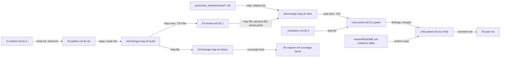

# 2026-10-24-1903-v-cr-abstract-review — architecture spec

## File tree

```text
bin/change-map.sh                                  new, builds, slices and summarizes the relation map of a change
personas/_shared/review/README.md                  new, the /v-cr review group: seats, boundaries, evidence table
personas/_shared/review/change-impact.md           new, callers and referrers the change leaves wrong
personas/_shared/review/test-gap.md                new, changed behaviour with no test, tests that pass for the wrong reason
personas/_shared/review/architecture-fit.md        new, layering, dependency direction, placement, contract changes
personas/_shared/review/pattern-conformance.md     new, does the change follow how this repo already does the same job
personas/_shared/review/intent-trace.md            new, each task requirement against the diff
personas/_shared/correctness.md                    existing, gains the map key and an intent-trace boundary
personas/_shared/quality.md                        existing, gains a pattern-conformance boundary
personas/_persona-template.md                      existing, documents the map key
personas/_shared/testing/README.md                 existing, test-gap boundary
personas/_resolution.md                            existing, adds the /v-cr seat rule
commands/_shared/critic-panel.md                   existing, caller seat rule, map input, context row, evidence pointer
commands/v-cr/steps/01-detect.md                   existing, resolves the head ref for the map
commands/v-cr/adapters.md                          existing, fetch_ref caller cell
commands/v-cr/steps/02-gather.md                   existing, builds and scrubs the relation map
commands/v-cr/steps/03-review.md                   existing, seats the review group and slices the map
commands/v-cr/steps/05-capture.md                  existing, records map counts
commands/v-cr.md                                   existing, one line naming the review group and the map
tests/fixtures/v-cr-seeded/mk-repo.sh              new, seeded and clean fixture repos
tests/unit/change-map.bats                         new, T1-T12
tests/unit/review-personas.bats                    new, T13-T16
tests/unit/v-cr.bats                               existing, T17-T21
tests/unit/cr-coverage.bats                        existing, retargeted test-file ownership guard
tests/unit/v-cr-abstract-review-c3.bats            new, T22
tests/fixtures/v-cr-abstract-review-c3/            new, scorer fixtures
checks/v-cr-abstract-review-C1.sh                  new, runs tests/unit/change-map.bats
checks/v-cr-abstract-review-C2.sh                  new, runs the group and wiring tests
checks/v-cr-abstract-review-C3.sh                  new, scores the saved runs against rebuilt fixtures
checks/v-cr-abstract-review-C4.sh                  new, pins the rule-line count
docs/reviewer-packs.md                             existing, review group row
vault/indications/cr-panel-spawn-and-visibility.md existing, Spawned example
vault/decisions/ADR-035-v-cr-single-task-review-seats.md   new, the decision record
vault/decisions/_inventory.md                      existing, ADR-035 row
vault/features/v-cr.md                             existing, seats and map behaviours
```

## Files

| path | new | purpose | loaded |
|------|-----|---------|--------|
| bin/change-map.sh | yes | Print the relation rows of a base..head change, slice them for one persona, and summarize their counts. | never-by-agent |
| personas/_shared/review/README.md | yes | Define the five /v-cr seats, what each owns and does not, and the evidence that confirms each kind of finding. | on-demand |
| personas/_shared/review/change-impact.md | yes | Find callers, referrers and companion files the change leaves inconsistent. | on-demand |
| personas/_shared/review/test-gap.md | yes | Find changed behaviour with no test and changed tests that pass for the wrong reason. | on-demand |
| personas/_shared/review/architecture-fit.md | yes | Judge layer, dependency direction, file placement and changed contracts against the repo's architecture records. | on-demand |
| personas/_shared/review/pattern-conformance.md | yes | Judge whether the changed code follows the pattern its sibling files already use for the same job. | on-demand |
| personas/_shared/review/intent-trace.md | yes | Sort each task requirement into compliant, not compliant or needs a human. | on-demand |
| personas/_shared/correctness.md | no | The logic-bug lens; gains `map: [caller]` and an intent-trace boundary. | on-demand |
| personas/_shared/quality.md | no | The reuse and simplicity lens; gains a pattern-conformance boundary. | on-demand |
| personas/_persona-template.md | no | The persona template; documents the optional `map:` key. | on-demand |
| personas/_shared/testing/README.md | no | The testing group; its boundaries name test-gap. | on-demand |
| personas/_resolution.md | no | Resolve the pack and select critics; gains §2.4, the /v-cr seat rule. | on-demand |
| commands/_shared/critic-panel.md | no | The single-pass panel; takes the caller's seat rule, the map input and the review-group evidence pointer. | on-demand |
| commands/v-cr/steps/01-detect.md | no | Detect the PR; §1.6 resolves the head ref for every forge PR. | on-demand |
| commands/v-cr/adapters.md | no | The adapter contract; the `fetch_ref` row names its two callers. | on-demand |
| commands/v-cr/steps/02-gather.md | no | Gather the review inputs; gains §2.4a, the relation-map build and scrub. | on-demand |
| commands/v-cr/steps/03-review.md | no | Run the panel; seats the review group and hands each seat its map slice. | on-demand |
| commands/v-cr/steps/05-capture.md | no | Record the review; the coverage block gains the map counts. | on-demand |
| commands/v-cr.md | no | The /v-cr dispatcher; names the review group and the map in one line. | on-demand |
| tests/fixtures/v-cr-seeded/mk-repo.sh | yes | Build the seeded repo with three planted defects and its clean control. | never-by-agent |
| tests/unit/change-map.bats | yes | Prove each relation, cap, slice rule, scrub and exit code of bin/change-map.sh. | never-by-agent |
| tests/unit/review-personas.bats | yes | Guard the review group contract. | never-by-agent |
| tests/unit/v-cr.bats | no | Guard the /v-cr command text; gains the wiring tests. | never-by-agent |
| tests/unit/cr-coverage.bats | no | Guard coverage rules; the test-file ownership test points at test-gap. | never-by-agent |
| tests/unit/v-cr-abstract-review-c3.bats | yes | Prove the C3 scorer passes and fails the right fixtures. | never-by-agent |
| tests/fixtures/v-cr-abstract-review-c3/pass.md | yes | A run file that meets C3. | never-by-agent |
| checks/v-cr-abstract-review-C1.sh | yes | Decide C1 by running tests/unit/change-map.bats. | never-by-agent |
| checks/v-cr-abstract-review-C2.sh | yes | Decide C2 by checking the backlog test titles and running the group and wiring tests. | never-by-agent |
| checks/v-cr-abstract-review-C3.sh | yes | Decide C3 by re-checking the saved runs' anchors against rebuilt fixtures. | never-by-agent |
| checks/v-cr-abstract-review-C4.sh | yes | Decide C4 by pinning the rule-line count. | never-by-agent |
| docs/reviewer-packs.md | no | The reviewer pack overview; gains the review group row. | on-demand |
| vault/indications/cr-panel-spawn-and-visibility.md | no | The panel spawn rule; its `Spawned:` example names the five seats. | on-demand |
| vault/decisions/ADR-035-v-cr-single-task-review-seats.md | yes | Record why /v-cr seats five single-task reviewers fed by a relation map. | on-demand |
| vault/decisions/_inventory.md | no | List every ADR; gains the ADR-035 row. | on-demand |
| vault/features/v-cr.md | no | The /v-cr feature dossier; gains the seats, the map and their behaviours. | on-demand |

## Data flow



## Interfaces

| interface | method | params | returns | throws | layer |
|-----------|--------|--------|---------|--------|-------|
| bin/change-map.sh | build | repo: path, base: ref, head: ref | six-field rows of the plan's Map row contract on stdout, then one `map-status` line; exit 0 | exit 2: repo is not a git repo, or a ref is not a commit | cli |
| bin/change-map.sh | slice | map: path, persona: path, paths: path | the `map-status` line, then the rows whose relation the persona's `map:` key lists, cut at `VCR_SLICE_BYTES` with a `withheld: <n> rows` line; exit 0 | exit 2: the map is unreadable, or the persona has no `map:` key | cli |
| bin/change-map.sh | status | map: path | `map_status:` and one `map_<relation>:` line per relation for the coverage block; exit 0 | exit 2: the map has no `map-status` line | cli |
| personas/_shared/review/<seat>.md | frontmatter | id: string, base_agent: string, map: list | the persona block and its map relations | - | persona |

## Load order

| trigger | loads | tokens-max |
|---------|-------|------------|
| /v-cr step 3 spawns a seat | personas/_shared/review/README.md | 1500 |
| /v-cr step 3 spawns a seat | that seat's persona file | 1200 |
| /v-cr step 3 spawns a seat | that seat's map slice | 4000 |

## Reuse map

| need | existing symbol | decision | reason |
|------|-----------------|----------|--------|
| changed-file list of the PR | commands/v-cr/steps/02-gather.md `CR_CHANGED_FILES` | reuse | the map reads the same base and head the list came from |
| PR head ref | commands/v-cr/adapters.md `fetch_ref` | extend | one fetch path keeps the host trust gate; it now runs without `--sandbox` too |
| every referrer of a changed file with its line | none | new | searched probes/harness.sh check_dead, which emits only unreferenced files, and lib/cr-helpers.sh, which has no reference query |
| excerpt secret scrub | lib/cr-sandbox.sh cr_redact_runtime | reuse | same token shapes as the step 2 diff scan |
| tab and control-byte sanitizer | lib/probe-emit.sh probe_sanitize | reuse | keeps a row at six fields |
| git env hardening | bin/probe-panel.sh | reuse | copy its `GIT_*` unset and absolute-PATH preamble |
| similar names elsewhere in the repo | probes/similar-symbols.sh | reuse | pattern-conformance cites its rows; the map adds siblings by directory and extension |
| coverage receipt per critic | commands/_shared/critic-panel.md FILES_EXAMINED | extend | the `context` row also covers a map target read in full |
| rule routing to seats | commands/v-cr/steps/03-review.md rule assignment | extend | rules routed to the architect seat go to architecture-fit |
| logic-bug lens | personas/_shared/correctness.md | reuse | joins /v-cr only on a §2.4 trigger |
| repo-pattern question | personas/_shared/quality.md pattern bullet | extend | pattern-conformance owns it on /v-cr; quality.md keeps it on /v-team |
| stack architect knowledge | personas/api-laravel.md Software Architect | reuse | a resolved pack's architect block becomes the architecture-fit overlay |
| fixture repo builder | tests/fixtures/sandbox-probe/mk-repo.sh sp_mk_repo | reuse | same sourced-function shape |
| group contract test | tests/unit/planning-personas.bats | reuse | review-personas.bats follows its checks |
| saved-run parser | checks/agent-systems-lens-C3.sh | extend | C3 parses FINDINGS blocks the same way and adds anchor re-checks |

## Size budgets

| path | max lines |
|------|-----------|
| bin/change-map.sh | 280 |
| personas/_shared/review/README.md | 90 |
| personas/_shared/review/pattern-conformance.md | 80 |
| personas/_shared/review/architecture-fit.md | 80 |
| personas/_shared/review/change-impact.md | 80 |
| personas/_shared/review/test-gap.md | 80 |
| personas/_shared/review/intent-trace.md | 80 |

## Config points

| key | file | default |
|-----|------|---------|
| VCR_MAP_CAP | bin/change-map.sh | 20 rows per relation per changed file |
| VCR_MAP_HISTORY | bin/change-map.sh | 500 commits read for co-change |
| VCR_MAP_MAX_COMMIT_FILES | bin/change-map.sh | 30 files; larger commits are skipped for co-change |
| VCR_SLICE_BYTES | bin/change-map.sh | 16000 bytes per seat slice |
