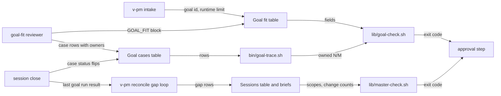

# 2026-11-08-1337-plan-goal-fit — architecture spec

## File tree

```text
templates/master-plan.md                        existing, owns the goal tables, phrases and change counting
templates/feature-plan.md                       existing, gains both goal tables
templates/VAULT.md                              existing, documents session_max_changes
templates/human-plan-sections.tsv               existing, renders both goal tables
lib/goal-check.sh                               new, cmd_goal
lib/goal-run.sh                                 new, S2 baseline, close, last and failing modes
lib/master-check.sh                             existing, gains master_resolve, phrase, merge and split refusals
bin/goal-trace.sh                               new, prints owned N/M
bin/gate.sh                                     existing, sources goal-check.sh and dispatches goal
bin/pm-plan.sh                                  existing, folds goal refusals; S2 adds gap
commands/v-pm/steps/01-intake.md                existing, asks the goal criterion and runtime limit
commands/v-pm/steps/03-plan-panel.md            existing, drafts the tables and seats goal-fit
commands/v-pm/steps/06-reconcile.md             existing, S2 gap loop
commands/v-pm/steps/07-status.md                existing, S2 shows goal state
commands/v-pm.md                                existing, prints the goal line
commands/v-team.md                              existing, runs gate.sh goal
commands/v-team/steps/03-propose-loop.md        existing, seats goal-fit, copies the block
commands/v-work/steps/03-propose.md             existing, prints the goal line
commands/v-work/steps/05-commit-capture.md      existing, S2 close-time goal steps
commands/_shared/feature-pickup.md              existing, S2 baseline run
personas/_shared/planning/goal-fit.md           new
personas/_shared/planning/delivery-planner.md   existing, over-split blocks, sizing counts changes
personas/_shared/planning/README.md             existing, lists goal-fit
personas/_resolution.md                         existing, seats goal-fit
vault/architecture/session-gates.md             existing, lists goal
vault/check-budget.md                           existing, rows for the new checks
vault/defect-ledger.md                          existing, rows for the two defects
tests/fixtures/goal/complete.md                 new
tests/fixtures/goal/device-sync-tests.md        new
tests/fixtures/goal/e2e-split.md                new
tests/unit/gate.bats                            existing
tests/unit/pm-plan.bats                         existing
tests/unit/planning-personas.bats               existing
tests/unit/v-pm.bats                            existing
tests/unit/v-team.bats                          existing
tests/unit/goal-run.bats                        new, S2
tests/unit/v-work.bats                          new, S2
checks/plan-goal-fit-C1.sh                      new
checks/plan-goal-fit-C2.sh                      new
checks/plan-goal-fit-C3.sh                      new
checks/plan-goal-fit-C4.sh                      new
checks/plan-goal-fit-C5.sh                      new
checks/plan-goal-fit-C6.sh                      new
.claude-plugin/plugin.json                      existing, 1.16.0 then 1.17.0
```

## Files

| path | new | purpose | loaded |
|------|-----|---------|--------|
| templates/master-plan.md | no | owns the goal tables, the deferral phrases, change counting and split reasons | on-demand |
| templates/feature-plan.md | no | gives a /v-pm plan both goal tables and the opt-in key | on-demand |
| templates/VAULT.md | no | documents the per-repo session_max_changes key | on-demand |
| templates/human-plan-sections.tsv | no | lists the plan sections on the operator page | never-by-agent |
| lib/goal-check.sh | yes | implements `gate.sh goal` | never-by-agent |
| lib/goal-run.sh | yes | runs the goal script at pickup and close and names failing cases | never-by-agent |
| lib/master-check.sh | no | resolves session_of once and refuses deferring, over-split and unreasoned small-tier rows | never-by-agent |
| bin/goal-trace.sh | yes | counts owned goal cases against the total | never-by-agent |
| bin/gate.sh | no | dispatches `goal` and runs it in the propose and approve phases | never-by-agent |
| bin/pm-plan.sh | no | folds goal refusals into `check` and appends gap rows | never-by-agent |
| commands/v-pm/steps/01-intake.md | no | makes the operator name the goal criterion and the runtime limit | on-demand |
| commands/v-pm/steps/03-plan-panel.md | no | drafts both tables and seats goal-fit | on-demand |
| commands/v-pm/steps/06-reconcile.md | no | runs the gap loop | on-demand |
| commands/v-pm/steps/07-status.md | no | shows ownership, baseline, last goal run and gap rounds | on-demand |
| commands/v-pm.md | no | prints the goal line at approval | on-demand |
| commands/v-team.md | no | runs `gate.sh goal` at approval | on-demand |
| commands/v-team/steps/03-propose-loop.md | no | seats goal-fit and copies its block into the master | on-demand |
| commands/v-work/steps/03-propose.md | no | prints the master's goal line for a session plan | on-demand |
| commands/v-work/steps/05-commit-capture.md | no | flips owned cases, rechecks on scope change, runs the last goal run | on-demand |
| commands/_shared/feature-pickup.md | no | runs the baseline goal run | on-demand |
| personas/_shared/planning/goal-fit.md | yes | the reviewer that lists goal cases, owners and failure paths | on-demand |
| personas/_shared/planning/delivery-planner.md | no | owns session sizing in changes | on-demand |
| personas/_shared/planning/README.md | no | lists the goal-fit lens and its seat | on-demand |
| personas/_resolution.md | no | seats goal-fit | on-demand |
| vault/architecture/session-gates.md | no | lists every gate subcommand | on-demand |
| vault/check-budget.md | no | records false-positive rates per check | on-demand |
| vault/defect-ledger.md | no | records each repaired defect and its test | on-demand |
| tests/fixtures/goal/complete.md | yes | a master plan that passes `gate.sh goal` | never-by-agent |
| tests/fixtures/goal/device-sync-tests.md | yes | the reported plan, opted in, for C4 | never-by-agent |
| tests/fixtures/goal/e2e-split.md | yes | the over-split givore plan for the merge test | never-by-agent |
| tests/unit/gate.bats | no | tests T1–T11 | never-by-agent |
| tests/unit/pm-plan.bats | no | test T12 | never-by-agent |
| tests/unit/planning-personas.bats | no | tests T13 and T16 | never-by-agent |
| tests/unit/v-pm.bats | no | tests T14 and T30 | never-by-agent |
| tests/unit/v-team.bats | no | test T15 | never-by-agent |
| tests/unit/goal-run.bats | yes | tests T21–T27 | never-by-agent |
| tests/unit/v-work.bats | yes | tests T28 and T29 | never-by-agent |
| checks/plan-goal-fit-C1.sh | yes | decides C1 | never-by-agent |
| checks/plan-goal-fit-C2.sh | yes | decides C2 | never-by-agent |
| checks/plan-goal-fit-C3.sh | yes | decides C3 | never-by-agent |
| checks/plan-goal-fit-C4.sh | yes | decides C4 | never-by-agent |
| checks/plan-goal-fit-C5.sh | yes | decides C5 | never-by-agent |
| checks/plan-goal-fit-C6.sh | yes | decides C6 | never-by-agent |
| .claude-plugin/plugin.json | no | carries the plugin version | never-by-agent |

## Data flow



## Interfaces

| interface | method | params | returns | throws | layer |
|-----------|--------|--------|---------|--------|-------|
| bin/gate.sh | goal | plan: path | exit 0 ok or silent, 1 refused, 2 unreadable | - | cli |
| bin/gate.sh | goal baseline | plan: path | exit 0 recorded or note, 1 first run passed or no script | - | cli |
| bin/gate.sh | goal close | plan: path, session: string, cases: string | exit 0 cases marked pass, 1 on a foreign flip or short ownership | - | cli |
| bin/gate.sh | goal last | plan: path | `goal: last run passed`, `failed`, `not run`, `waits` or `already running`; exit 0 | - | cli |
| bin/gate.sh | goal failing | plan: path | failing case ids from the saved log; exit 1 without a log | - | cli |
| bin/goal-trace.sh | trace | plan: path | `owned N/M` and unowned rows; exit 0 full, 1 short, 2 unreadable | - | cli |
| bin/pm-plan.sh | gap | plan: path, cases: string | one row per repo appended, gap_rounds bumped; exit 1 at 3 | - | cli |
| lib/goal-check.sh | cmd_goal | plan: path | `REFUSED goal <plan>:` lines, `goal: ok <plan>` | die on unreadable file | lib |
| lib/master-check.sh | master_resolve | plan: path, session_of: string | master path on stdout, 1 when unresolved | - | lib |

## Load order

| trigger | loads | tokens-max |
|---------|-------|------------|
| /v-pm step 3 (c) or /v-team step 3 (b) seats goal-fit | personas/_shared/planning/goal-fit.md | 2500 |
| goal-fit reviewer starts | the master plan.md (device-sync-tests: 60677 bytes) | 16000 |
| goal-fit reviewer checks one session | that session's brief, by id | 5000 |
| a session closes | commands/v-work/steps/05-commit-capture.md goal steps | 1500 |

## Reuse map

| need | existing symbol | decision | reason |
|------|-----------------|----------|--------|
| read a section's table | bin/gate.sh table_rows | reuse | parses every plan table the gates read |
| find a column | bin/gate.sh col_index | reuse | same header format |
| read a frontmatter key with comments and CRLF | lib/arch-check.sh arch_fm_value | reuse | frontmatter_get keeps a trailing comment |
| resolve session_of to a master file | lib/master-check.sh master_order_check | extend | the resolution moves into master_resolve, which both checks call |
| refuse a scope phrase, an over-split pair | lib/master-check.sh master_problems | extend | it already walks every Sessions row |
| fold sub-gate refusals into pm-plan check | bin/pm-plan.sh cmd_check | extend | the same loop folds master today |
| find a session's brief | bin/pm-plan.sh brief_of | reuse | already maps an id to its brief |
| write or append a table row | bin/pm-plan.sh cmd_set | extend | its awk moves to bin/gate.sh `table_set`; `table_append` builds a row from the header |
| a planning lens shape | personas/_shared/planning/delivery-planner.md | reuse | the six-section shape the group tests enforce |

## Size budgets

| path | max lines |
|------|-----------|
| lib/goal-check.sh | 180 |
| lib/goal-run.sh | 220 |
| bin/goal-trace.sh | 120 |
| personas/_shared/planning/goal-fit.md | 150 |
| templates/master-plan.md | 140 |

## Config points

| key | file | default |
|-----|------|---------|
| session_max_changes | VAULT.md | 15 |
| goal_fit | plan frontmatter | absent, which means a warning only |
